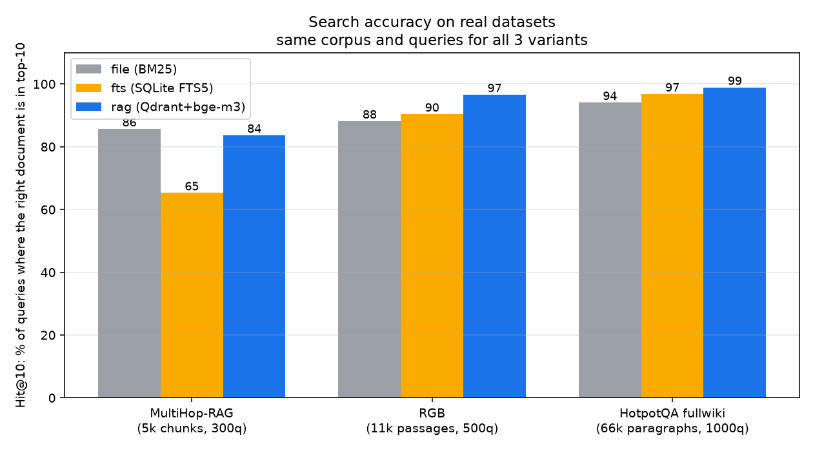
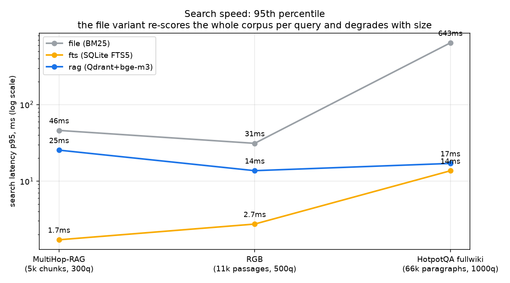
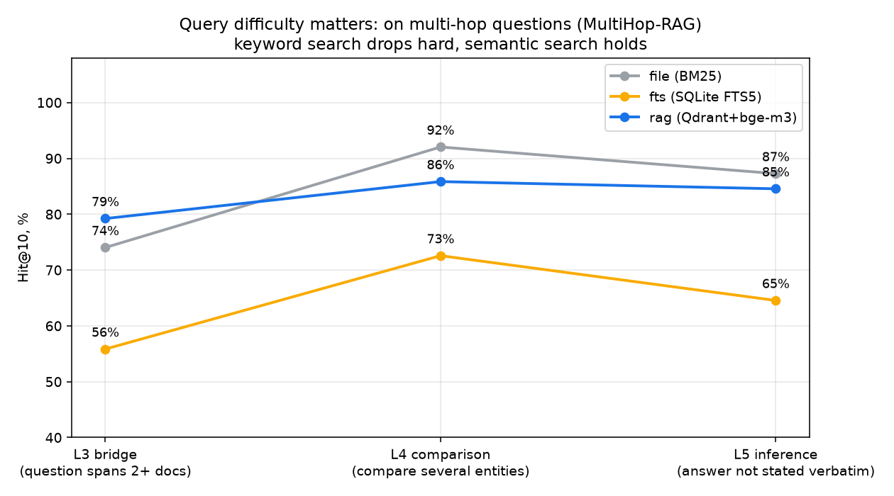
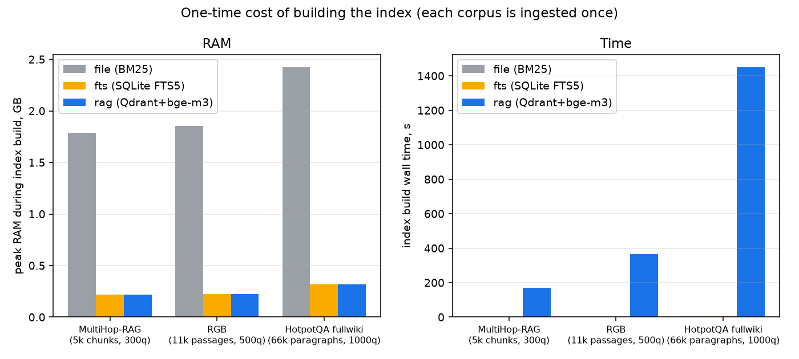

# Когда нужен RAG, а когда достаточно поиска по словам? — бенчмарк на реальных датасетах

Сравнение трёх способов «памяти» базы знаний: одинаковый корпус, одинаковое чанкование, одинаковые запросы с gold-ответами — разный способ поиска.

| Вариант | Что это |
|---|---|
| **file** | Документы в файлах + BM25-поиск в памяти (прокси «агент сам перебирает файлы») |
| **fts** | SQLite FTS5 — классический поиск по словам, без ML |
| **rag** | Qdrant + bge-m3 (1024-dim эмбеддинги) — векторный поиск по смыслу |

## Данные: три открытых датасета с gold-документами

| Шкала | Источник | Корпус | Запросы | Тип вопросов |
|---|---|---|---|---|
| real-mh | [MultiHop-RAG](https://huggingface.co/datasets/yixuantt/MultiHopRAG) (COLM'24) | 609 новостей → 5 078 чанков | 300 | multi-hop: мостовые (L3), сравнения (L4), выводы (L5) |
| real-rag-10k | [RGB](https://github.com/chen700564/RGB) (AAAI'24) | 11 128 пассажей | 500 | точные факты (L1), вопросы по нескольким документам (L3), контрфакты (L4) |
| real-rag-66k | [HotpotQA fullwiki](https://huggingface.co/datasets/hotpotqa/hotpot_qa) (val) | 66 581 вики-параграфов | 1000 | bridge и comparison (L3/L4), gold — параграфы-поддержки |

Почему эти: каждый self-contained (корпус + вопросы + «правильные» документы в комплекте,
скачиваются без регистрации), покрывают лестницу масштабов 5k → 11k → 66k чанков и
разные типы вопросов — от точного факта до вопроса, ответ на который сформулирован
иначе, чем в документе. Конвертация в единый формат — `harness/real/convert.py`
(детерминированная, seed=42, без LLM).

## Методика

**Однаковость.** Все три варианта работают на одном и том же корпусе с одинаковым
чанкованием (~1500 символов, разбивка по абзацам и концам предложений) — иначе
сравнение мутится. Корпус общий для всех вариантов, конвертируется один раз.

**Gold-ответы.** Для каждого запроса заранее известны «правильные» чанки:
- HotpotQA — официальные supporting_facts (title → параграф);
- RGB — positive-пассажи по совпадению текста (100% покрытие);
- MultiHop-RAG — evidence-факты: чанк считается gold, если содержит факт-поддержку
  (без поддержки выбыло 46/2556 — они исключены из gold, запросы сохранены).

**Метрики релевантности (retrieval-этап, без LLM):**
- **Hit@k** (k=1,3,5,10) — доля запросов, где хотя бы один gold-чанк попал в топ-k;
- **MRR@10** — среднее 1/позиция первого найденного gold-чанка (насколько высоко);
- **Overlap@5** — насколько топ-5 лексически перекрывается с эталонными ответами.

**Ресурсы и цена** — на каждой точке (вариант × датасет):
- индексация (одноразово): wall-time, пик RAM (ru_maxrss из /proc/self/status), CPU-с;
- поиск: задержка p50/p95/p99 по всем запросам датасета, пик RAM;
- embedding-стоимость RAG: число токенов и ток/с на эмбеддинге корпуса.

**Среда.** Ryzen AI MAX 395 (32 CPU), 32 ГБ RAM, все модели локальные:
Qdrant v1.15.4, bge-m3 (GGUF Q4_K_M, llama-server, флаг `-ub 1024`). Поиск в RAG —
эмбеддинг запроса + ANN-поиск, без LLM в цикле.

## Результаты

| Корпус | Hit@10: file / fts / rag | MRR@10: file / fts / rag | p95: file / fts / rag |
|---|---|---|---|
| real-mh (5k, multi-hop) | 85.7% / 65.3% / 83.7% | 0.55 / 0.38 / 0.50 | 46мс / 1.7мс / 25мс |
| real-rag-10k (11k) | 88.2% / 90.4% / **96.6%** | 0.60 / 0.64 / **0.78** | 31мс / 2.7мс / 13.7мс |
| real-rag-66k (66k) | 94.1% / 96.8% / **98.9%** | 0.73 / 0.80 / **0.93** | **642мс** / 13.6мс / **17мс** |

По уровням сложности (Hit@10, multi-hop-вопросы MultiHop-RAG):

| уровень | file | fts | rag |
|---|---|---|---|
| L3 bridge (вопрос по 2+ документам) | 74% | 56% | 79% |
| L4 comparison (сравнить несколько сущностей) | 92% | 73% | 86% |
| L5 inference (ответ не сформулирован в документе) | 87% | 65% | 85% |









## Главный вывод — правило выбора

> **RAG нужен, когда данных много (от ~10 тыс. чанков) ИЛИ когда люди задают вопросы «своими словами» — без точных слов из документов. Иначе — обычный поиск по словам: он так же точен, в 10 раз быстрее и ничего не стоит. Голые файлы живут до ~10 тыс. чанков, потом умирают по задержке и памяти.**

Обоснование в цифрах:

1. **RAG ведёт по точности на всех трёх датасетах** (83.7–98.9% Hit@10 против 85.7–96.8% у
   поиска по словам), и разрыв растёт с размером: на 66k — +4.8 п.п. По MRR разрыв ещё больше
   (0.93 против 0.80 на 66k): RAG не просто «находит в топ-10», а ставит нужное первым.
2. **Поиск по словам проваливается на «живых» вопросах**: на multi-hop (длинные вопросы-пересказы)
   FTS5 — 65.3% против 83.7% у RAG, по всем трём уровням сложности отставание 13–17 п.п.
   Причина структурная: OR-склейка ключевиков ранжирует частотой слов, а не смыслом.
3. **Файлы умирают на объёме**: на 66k чанков p95 поиска — 642 мс (каждый запрос — полный
   перебор корпуса), пик RAM — 2.5 ГБ. На 5k ещё конкурентен (85.7% Hit@10), но уже держит
   весь корпус в памяти.
4. **Цена RAG приемлемая и одноразовая**: индексация 66k чанков — 24 минуты,
   пик RAM Qdrant — 330 МБ, сам поиск — 17 мс p95. На 5k — 2.8 минуты.

## Честные ограничения

- Все три датасета — **английские**; bge-m3 мультиязычный, но RU-корпус не проверялся.
- Только retrieval-этап (LLM-judge и end-to-end качество ответа ещё не прогонялись).
- HotpotQA — вики-параграфы: «66k чанков» не обязательно эквивалентно 66k произвольных
  документов (структура и длина кусков влияют на поведение).
- Gold по MultiHop-RAG — по containment evidence-фактов: жёстче, чем у HotpotQA/RGB.
- Hybrid (вектор + BM25 + rerank) не сравнивался — вероятный следующий кандидат;
  по уровню (L3/L4) он должен закрыть разрыв fts/rag.

## Что внутри

```
harness/
  bench.py            # весь стенд: index / search / judge (gen-corpus — для синтетики)
  report.py           # агрегация metrics.json -> summary.csv + report.md
  pipeline_real.sh    # сквозной прогон по трём реальным датасетам
  real/download.py    # скачивание MultiHop-RAG / RGB / HotpotQA
  real/convert.py     # конвертация в единый формат (chunks + queries + gold, seed=42)
corpus/
  chunks_real-*.jsonl # корпуса трёх датасетов
  raw_real/           # исходники датасетов
queries/
  queries_real-*.jsonl# запросы с gold chunk ids и уровнями сложности
results/
  summary.csv         # все метрики (variant, scale, metric, value)
  report.md           # сводные таблицы
  {variant}_{scale}/  # metrics.json + search_results.jsonl (по запросу: топ-10 + gold)
images/               # графики (make_charts.py перестраивает из summary.csv)
```

## Как повторить

Зависимости: Qdrant (:6333), bge-m3 через llama-server (:8002, флаг `-ub 1024` обязателен),
Python 3.11+ (`pip install -r requirements.txt`).

```bash
# реальные датасеты (одноразово): скачать и сконвертировать
python3 harness/real/download.py && python3 harness/real/convert.py

# индексация и поиск: каждый вариант x каждый датасет
python3 harness/bench.py index  --variant {file,fts,rag} --scale {real-mh,real-rag-10k,real-rag-66k}
python3 harness/bench.py search --variant {file,fts,rag} --scale {...}
python3 harness/report.py       # -> results/summary.csv, report.md
python3 make_charts.py          # -> images/*.png
```

## В две строки (для резюме)

> Собирал стенд сравнения способов поиска по базе знаний: 3 варианта (файлы / поиск по словам / векторный RAG) × 3 реальных датасета (5–66 тыс. документов), 1800 запросов с gold-ответами, метрики точности и задержки.
> Вывод: векторный поиск оправдан от ~10 тыс. документов или при неформальных вопросах — на 66 тыс. документов +4.8 п.п. точности при 17 мс на запрос (p95); поиск по словам так же точен на мелких корпусах и в 10 раз дешевле.
